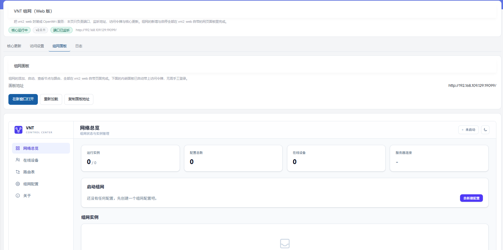
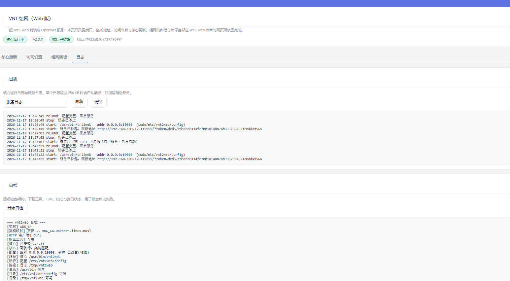

# luci-app-vnt2web —— OpenWrt 上的 VNT 组网（Web 版）

把 [vnt-dev/vnt](https://github.com/vnt-dev/vnt) 的 **`vnt2_web`** 核心封装成 OpenWrt 的服务与 LuCI 界面。

**这是一个「壳」**：不含任何 vnt 二进制，只负责四件事——

1. 设置**监听端口**与**访问令牌**
2. 按架构**在线下载/更新核心**（支持镜像前缀与网络代理）
3. 启动后把虚拟网卡**接入防火墙区域**

**组网的添加、启动、查看节点与路由，全部在 `vnt2_web` 自带的网页面板里完成。** 本插件不重复造界面，只做托管与配置。

> 与封装 `vnt2_cli` 的版本相比：`vnt2_web` 自带网页界面，因此**不需要**在 LuCI 里逐项配置组网参数（组网编号、服务端、密码、点对网等），那些都在面板里填。LuCI 这边只留运行所需的几项。

## 界面

入口在 LuCI 的 **VPN → VNT2WEB**。页面顶部是状态条（核心版本 / 运行状态 / 面板地址），
下方四个标签：

**核心更新** —— 版本信息、检查更新、下载/更新核心、测试连通性


**访问设置** —— 启用服务、监听端口、访问令牌、存储路径、更新源与代理


**组网面板** —— `vnt2_web` 原生界面内嵌，令牌自动注入，打开即用



**日志** —— 核心 / 服务 / 更新日志查看，以及逐项自检



## 特性

- **配置极简**：只需端口 + 访问令牌，其余在面板里配
- **令牌留空即自动生成**：至少 16 位，由核心在首次启动时生成
- **免登录打开面板**：内嵌与跳转都自动带上 `?token=`，不用手工粘贴
- **面板内嵌显示**：在 LuCI 页面里直接操作组网，也可在新窗口打开
- **核心运行时下载**：插件本身很小（约 33 KB），首次使用时按架构拉取核心
- **升级固件不丢核心**：核心存 `/etc/vnt2web`，`sysupgrade` 后依然在
- **一键更新核心**：vnt 发新版后点一下即可，失败自动回滚
- **镜像 + 代理双加速**：`mirror` 改 URL，`proxy` 走隧道（socks5/http）
- **支持的架构**：`x86_64`、`aarch64`、`armv7`(hf/eabi)、`armv6`、`mips`、`mipsel`
- **绑定地址可选**：`0.0.0.0` 让局域网设备也能打开面板；`127.0.0.1` 更安全
- **存储路径可配**：核心二进制与配置目录都能指定位置；日志固定 `/tmp` 不磨损 Flash
- **标签页界面**：插件设置 / 运行信息 / 运行日志分页，不再一屏堆叠

## 安装

### 方式一：直接安装（推荐）

到 [Releases](../../releases) 下载 `luci-app-vnt2web_<版本>-1_all.ipk`：

```sh
opkg install /tmp/luci-app-vnt2web_1.0.0-1_all.ipk
```

> 依赖 `luci-base`、`rpcd`、`kmod-tun`、`unzip`。
> `unzip` 用于解压核心包，若缺失请先 `opkg update && opkg install unzip`。

### 装不上或报依赖错误时

**第三方固件（LEDE / Lean / ImmortalWrt / iStoreOS 等）** 的软件源与官方不同，
包名可能对不上，opkg 会报 `Cannot satisfy the following dependencies`。按顺序试：

```sh
# 1) 先更新源列表再装
opkg update
opkg install /tmp/luci-app-vnt2web_1.0.0-1_all.ipk

# 2) 若仍报依赖，手动补上缺的那个
opkg install unzip
opkg install kmod-tun

# 3) 固件确实没有对应包时，强制忽略依赖
#    （本插件是纯脚本 + 前端，运行只依赖 shell 与 rpcd
#     缺 unzip 只影响「下载核心」这一步）
opkg install --force-depends /tmp/luci-app-vnt2web_1.0.0-1_all.ipk
```

### 方式二：接入 OpenWrt 编译

见下方[「接入 OpenWrt 编译」](#接入-openwrt-编译)。简言之：

```sh
cp -a luci-app-vnt2web/luci-app-vnt2web package/
make package/luci-app-vnt2web/compile V=s
```

### 方式三：免 SDK 自行打包（不搭环境，最快）

```sh
cd luci-app-vnt2web
python scripts/build-ipk.py   # 产出 dist/luci-app-vnt2web_<版本>-1_all.ipk
```

> 纯 Python、无需 SDK 与 `ar`/`tar`，Windows 上也能出包。
> `PKGARCH=all`：一份包通吃全架构（核心在运行时按架构下载）。

## 使用（三步）

**第一步：下载核心**

LuCI → **VPN → VNT2WEB** → 「检查更新」，确认可下载后点「下载核心」。

> 网络不通时先到「访问设置」配置镜像前缀（如 `https://ghfast.top`）或代理，
> 回到「核心更新」点「测试连通性」验证链路。

**第二步：设置端口与令牌**

| 字段 | 说明 |
|------|------|
| 监听端口 | 默认 `19099`，与其它应用冲突时改掉 |
| 访问令牌 | 至少 16 位；**留空则首次启动时自动随机生成** |

监听地址固定为 `0.0.0.0`（局域网内可直接打开面板），不提供配置项 ——
需要限制访问时用防火墙规则更合适。

勾选「启用服务」→「保存并应用」。

**第三步：组网**

在「组网面板」标签直接操作（内嵌的 `vnt2_web` 页面），或点「在新窗口打开」。
在面板中新建组网配置，填**组网编号**、**服务端地址**、**组网密码**：

- **组网编号**：标识虚拟网络，如 `123456`。所有需要互联的设备必须一致
- **服务端地址**：公共服务端 `vnt2.rustvnt.com:29872`，或自建服务端
- **组网密码**：建议填写，节点间端到端加密

## 访问方式

安装后可配置一个端口（默认 `19099`）：

| 场景 | 地址 |
|------|------|
| LuCI 内嵌面板 | 自动带令牌，无需登录 |
| 新窗口打开 | 点「在新窗口打开」，同样带令牌 |
| 局域网直连 | `http://路由器IP:19099/`（需绑定地址为 `0.0.0.0`） |

### 令牌与免登录

`vnt2_web` 的接口用 `Authorization: Bearer <token>` 校验，令牌**至少 16 位**。

本插件的做法：

- 令牌存 `/etc/vnt2web/token`（0600），同时同步到 UCI，界面可直接显示
- 传给核心时走**环境变量** `VNT_WEB_TOKEN`，不写入命令行，避免出现在 `ps` 输出里
- 面板地址拼上 `?token=xxx` —— 这是 `vnt2_web` 前端支持的方式：
  它会读取该参数存入 localStorage 完成登录，并把地址栏里的令牌抹掉

因此**内嵌与跳转都不需要手工粘贴令牌**。界面展示用的是不含令牌的地址，避免泄露。

## 核心更新源

| 配置 | 作用层 | 说明 |
|------|--------|------|
| **镜像前缀** | URL 层 | 把下载地址改写到镜像站，如 `https://ghfast.top` |
| **网络代理** | 网络层 | 让请求经代理隧道，适合本机需要代理才能上外网 |

代理支持 `socks5h://`（推荐，由代理解析 DNS）、`socks5://`、`socks4://`、`http://`。
**走代理需要系统已安装 curl**（`uclient-fetch` 不支持 SOCKS5）。

版本号查询有三个来源，依次尝试：`latest.json` → `releases/latest` 重定向 → GitHub API。

## 命令行

```sh
/etc/init.d/vnt2web start|stop|restart|reload|enable|disable
/etc/init.d/vnt2web status          # 运行状态与面板地址
/etc/init.d/vnt2web panel           # 打印带令牌的面板地址
/etc/init.d/vnt2web diag            # 自检
/etc/init.d/vnt2web check_update    # 查询最新核心版本
/etc/init.d/vnt2web update_core     # 下载并安装最新核心
/etc/init.d/vnt2web log             # 查看日志
```

## 目录结构

仓库根是一个 **OpenWrt feed**，包本体在 `luci-app-vnt2web/` 子目录下：

```
luci-app-vnt2web/                     # 仓库根 = feed
├── .github/workflows/
│   ├── build.yml                     # 免 SDK 自建 ipk + 测试（快）
│   └── build-sdk.yml                 # SDK 矩阵真实编译（可选）
├── docs/screenshots/                 # 界面截图
├── LICENSE                           # MIT
└── luci-app-vnt2web/                 # ← 包本体
    ├── Makefile                      # OpenWrt 包定义（用 feeds/luci/luci.mk）
    ├── root/                         # 原样安装到设备 /
    │   ├── etc/
    │   │   ├── config/vnt2web        # UCI 默认配置（conffile）
    │   │   ├── init.d/vnt2web        # procd 服务
    │   │   └── uci-defaults/95-vnt2web   # 安装初始化
    │   ├── usr/libexec/rpcd/vnt2web  # LuCI 后端（ubus 对象 vnt2web）
    │   ├── usr/share/rpcd/acl.d/     # 权限声明
    │   ├── usr/share/luci/menu.d/    # 菜单注册
    │   └── usr/share/vnt2web/
    │       ├── vnt.sh                # 基础层：路径、架构映射、HTTP、版本、令牌
    │       └── vnt-core.sh           # 核心层：安装/回滚、进程、防火墙
    ├── htdocs/luci-static/resources/view/vnt2web/client.js   # 前端界面
    └── scripts/                      # 免 SDK 打包与测试（不参与 OpenWrt 编译）
```

> `root/` 与 `htdocs/` 是 OpenWrt 包的**标准目录名**，`luci.mk` 会自动处理：
> `root/` 原样装到设备根、`htdocs/` 装到 `/www`、`root/etc/uci-defaults/` 自动执行。
> 因此 Makefile 里**不需要手写 install 段**。

## 接入 OpenWrt 编译

**方式一：作为 feed 加入**（推荐，便于跟随上游更新）

```sh
# 在 OpenWrt buildroot 根目录
echo 'src-git vnt2web https://github.com/virkingz/luci-app-vnt2web.git' \
  >> feeds.conf.default
./scripts/feeds update vnt2web
./scripts/feeds install luci-app-vnt2web
make menuconfig      # LuCI → Applications → luci-app-vnt2web
make package/luci-app-vnt2web/compile V=s
```

**方式二：直接拷包目录**

```sh
cp -a luci-app-vnt2web/luci-app-vnt2web package/
make package/luci-app-vnt2web/compile V=s
```

两种方式产出的 ipk 与仓库 Release 里的等价。
若只想快速拿包、不搭 SDK，用下面的免 SDK 打包即可。

## 运行时数据与存储路径

三类数据分开存放，其中**后两类路径可自定义**（LuCI →「存储路径」）：

| 数据 | 默认位置 | 可配置 | 说明 |
|------|----------|--------|------|
| 核心二进制 | `/usr/bin/vnt2web` | ✅ `bin_path` | 单个可执行文件 |
| 组网配置 | `/etc/vnt2web/config` | ✅ `config_dir` | 核心在此建 `vnt_config/` |
| 运行日志 | `/tmp/vnt2web/` | ❌ 固定 | 内存盘，重启即清，不磨损 Flash |
| 访问令牌 | `/etc/vnt2web/token` | ❌ | 0600，升级固件后保留 |
| 版本/来源标记 | `/etc/vnt2web/` | ❌ | 随配置而非随 bin，换路径不丢状态 |
| 下载缓存/回滚备份 | `/tmp/vnt2web/run/` | ❌ | 内存盘 |

### 路径选择建议

**核心二进制默认在 `/usr/bin/vnt2web`**：

- `/usr` 在升级固件时会被系统替换 —— 若把核心放这里，**升级固件后需要重新下载**
- 想升级固件后保留核心，改到 `/etc` 下，如 `/etc/vnt2web/bin/vnt2_web`
- 想节省内置 Flash，改到挂载的 U 盘，如 `/mnt/sda1/vnt2_web`

**配置目录默认在 `/etc/vnt2web/config`**：放 `/etc` 下是有意的 ——
`sysupgrade` 升级固件时只保留 `/etc`，组网配置得以延续。

### 日志为什么固定放 /tmp

OpenWrt 设备多为 NOR/NAND Flash，写入寿命有限。日志高频追加会显著磨损 Flash，
因此固定放内存盘 `/tmp`（重启即清）。单个日志超过 **256 KB** 时原地截断保留最近 128 KB。

用「原地截断」而非「改名轮转」，是因为核心日志由 `vnt2_web` 以追加方式持有文件句柄写入，
改名会让它继续写旧 inode、轮转失效。

## 排障

| 现象 | 处理 |
|------|------|
| 无法下载核心 | 「访问设置」配镜像前缀或代理，回「核心更新」点「测试连通性」验证；确认已装 `unzip` |
| 启动失败 | 看「日志」标签的 `main.log`（启动失败的原因与核心日志尾部都会记在这里） |
| 面板空白/打不开 | 确认核心在运行且「端口已监听」；用「在新窗口打开」直连排查 |
| 提示缺少 TUN | `opkg install kmod-tun` |
| 内嵌面板显示异常 | 用「在新窗口打开」直接访问；部分浏览器对 iframe 有限制 |
| 令牌忘了 | 在「访问设置」重新填一个（≥16 位）并保存；或清空后保存，让核心重新生成 |
| 显示「已停止」但面板能开 | 状态检测依次看 PID 文件、procd 实例状态、进程路径；若都不中，`ubus call service list '{"name":"vnt2web"}'` 看 procd 是否认为在跑 |
| 更新后组网不通 | 更新失败会自动回滚，备份在 `/var/run/vnt2web/vnt2_web.bak` |

## 上游

- VNT 项目：https://github.com/vnt-dev/vnt
- VNT 服务端：https://github.com/vnt-dev/vnts
- 本项目的飞牛版：https://github.com/virkingz/fnos-vnt2

## 许可

MIT
